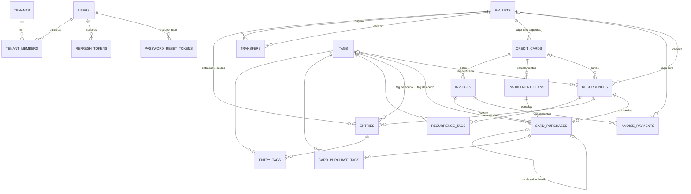
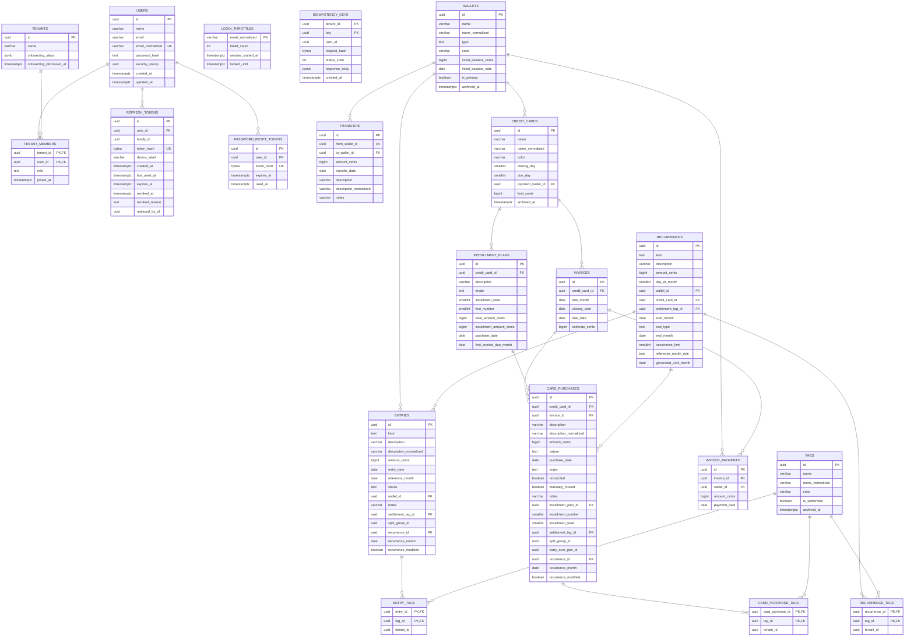

# Modelo de dados do Fin-My

Banco PostgreSQL, nomes em `snake_case`. Regras gerais em [`arquitetura.md`](arquitetura.md) §3–§5.
Cada requisito citado (ex.: `002 FR-015`) está na spec correspondente.

## Convenções

- **PK**: `id uuid` (UUID v7 gerado pela aplicação), exceto tabelas de ligação (PK composta).
- **Colunas padrão de tabela de Espaço** (marcadas como `[padrão]` abaixo; vêm de `TenantEntity`,
  preenchidas só por interceptors):

  | Coluna | Tipo | Nulo | Observação |
  |---|---|---|---|
  | `id` | uuid | não | PK |
  | `tenant_id` | uuid | não | FK `tenants(id)`; `UNIQUE (tenant_id, id)` |
  | `created_at` | timestamptz | não | |
  | `created_by` | uuid | não | `users.id` ou usuário de sistema (sem FK) |
  | `created_via` | text | não | `app`, `claude`, `system` (008) |
  | `updated_at` | timestamptz | não | |
  | `updated_by` | uuid | não | |
  | `updated_via` | text | não | idem |
  | `deleted_at` | timestamptz | sim | soft delete |
  | `deleted_by` | uuid | sim | |
  | `deletion_batch_id` | uuid | sim | lote para "Desfazer" |
  | `xmin` | xid (sistema) | — | token de concorrência; não é coluna criada |

- **FKs entre tabelas de Espaço são compostas** `(tenant_id, x_id) → x (tenant_id, id)`
  (arquitetura §3.5). Nas tabelas abaixo, "FK → wallets" significa essa FK composta.
- **Dinheiro**: `bigint` em centavos (`*_cents`). **Datas**: `date`. **Mês**: `date` com dia 1
  (`CHECK (extract(day from col) = 1)`).
- **Enums**: `text` com `CHECK (col IN (...))`; valores em inglês, `snake_case`.
- **`*_normalized`**: texto em minúsculas, sem acentos e sem espaços nas pontas, calculado pela
  aplicação ao gravar; usado para unicidade e busca (RT-05a, 002 FR-011/FR-025).
- **Cor**: `varchar(7)` no formato `#RRGGBB`.
- Índices únicos de negócio são parciais: `WHERE deleted_at IS NULL`.

## Diagrama 1 — Relacionamentos

> Todas as tabelas financeiras também têm `tenant_id → tenants` (omitido para não poluir).

## Diagrama 2 — Colunas

> Colunas `[padrão]` (auditoria, soft delete, tenant) omitidas; ver Convenções.

---

## Tabelas globais (sem Espaço)

### `users` — 001

| Coluna | Tipo | Nulo | Regras |
|---|---|---|---|
| id | uuid | não | PK |
| name | varchar(60) | não | 1–60 após trim (001 FR-001) |
| email | varchar(254) | não | como digitado (trim) |
| email_normalized | varchar(254) | não | **UNIQUE**; minúsculas + trim (001 FR-003) |
| password_hash | text | não | `PasswordHasher` |
| security_stamp | uuid | não | trocado ao mudar senha |
| created_at / updated_at | timestamptz | não | |

### `tenants` — Espaço, 001 / 006

| Coluna | Tipo | Nulo | Regras |
|---|---|---|---|
| id | uuid | não | PK |
| name | varchar(60) | não | padrão "Finanças de <primeiro nome>" (001 FR-004) |
| onboarding_steps | jsonb | não | `{}` padrão; ex.: `{"wallets":"done","cards":"skipped"}` (006 FR-007) |
| onboarding_dismissed_at | timestamptz | sim | |
| created_at, created_by, updated_at, updated_by | | não | auditoria (sem soft delete) |

### `tenant_members` — Participação, 001 FR-005

| Coluna | Tipo | Nulo | Regras |
|---|---|---|---|
| tenant_id | uuid | não | PK, FK `tenants` |
| user_id | uuid | não | PK, FK `users`; índice |
| role | text | não | `CHECK IN ('owner')` (v1) |
| joined_at | timestamptz | não | |

v1: `UNIQUE (user_id)` (um Espaço por usuário) e `UNIQUE (tenant_id)` (um participante por Espaço) —
**restrições que serão removidas** quando houver compartilhamento; nenhuma outra parte do modelo muda.

### `refresh_tokens` — sessões, 001 FR-009/FR-012

| Coluna | Tipo | Nulo | Regras |
|---|---|---|---|
| id | uuid | não | PK |
| user_id | uuid | não | FK `users`, índice |
| family_id | uuid | não | rotação/detecção de reuso |
| token_hash | bytea | não | UNIQUE, SHA-256 |
| device_label | varchar(120) | sim | ex.: "Chrome · Android" |
| created_at, last_used_at | timestamptz | não | |
| expires_at | timestamptz | não | `last_used_at + 90 dias` |
| revoked_at | timestamptz | sim | |
| revoked_reason | text | sim | `logout, rotated, reuse_detected, password_changed, password_reset` |
| replaced_by_id | uuid | sim | |

### `password_reset_tokens` — 001 FR-011

`id` PK; `user_id` FK; `token_hash bytea UNIQUE`; `created_at`; `expires_at` (+1 h); `used_at` nulo.

### `login_throttles` — 001 FR-010

`email_normalized varchar(254)` PK (existe ou não conta); `failed_count int`; `window_started_at`;
`locked_until` nulo.

### Tabelas do OpenIddict — 008

`openiddict_applications`, `openiddict_authorizations`, `openiddict_scopes`, `openiddict_tokens`,
criadas pelo próprio OpenIddict (esquema padrão). "Aplicativos conectados" (008 FR-003) = autorizações
válidas do usuário.

### `idempotency_keys` — arquitetura §6

PK `(tenant_id, key)` (`key uuid`, o valor do cabeçalho `Idempotency-Key`); `user_id`; `request_hash bytea`; `status_code int`; `response_body jsonb`;
`created_at`. Expurgo > 24 h. Não é `TenantEntity` (sem auditoria/soft delete), mas tem filtro de Espaço.

---

## Tabelas do Espaço

### `wallets` — Carteira, 002 FR-001..004

| Coluna | Tipo | Nulo | Regras |
|---|---|---|---|
| [padrão] | | | |
| name | varchar(40) | não | |
| name_normalized | varchar(40) | não | `UNIQUE (tenant_id, name_normalized) WHERE deleted_at IS NULL` |
| type | text | não | `checking, digital, savings, cash, meal_voucher, other` |
| color | varchar(7) | não | |
| initial_balance_cents | bigint | não | qualquer sinal (exceção RT-02) |
| initial_balance_date | date | não | |
| is_primary | boolean | não | `UNIQUE (tenant_id) WHERE is_primary AND archived_at IS NULL AND deleted_at IS NULL` |
| archived_at | timestamptz | sim | RT-11; `CHECK (NOT (is_primary AND archived_at IS NOT NULL))` |

### `entries` — Entrada/Saída, 002, 004, 005

| Coluna | Tipo | Nulo | Regras |
|---|---|---|---|
| [padrão] | | | |
| kind | text | não | `income, expense` |
| description | varchar(80) | não | RT-05a |
| description_normalized | varchar(80) | não | índice `(tenant_id, description_normalized)` |
| amount_cents | bigint | não | `CHECK (amount_cents > 0 AND amount_cents <= 999999999)` |
| entry_date | date | não | 2000-01-01..2100-12-31 |
| reference_month | date | não | dia 1; RT-04; índice `(tenant_id, reference_month)` |
| status | text | não | `planned, settled`; índice `(tenant_id, status, reference_month)` (pendências 002 FR-019) |
| wallet_id | uuid | não | FK → wallets |
| notes | varchar(500) | sim | |
| settlement_tag_id | uuid | sim | FK → tags; a tag MUST ter `is_settlement = true` (validado na aplicação) — 004 FR-002 |
| split_group_id | uuid | sim | partes de uma divisão (004 FR-014) |
| recurrence_id | uuid | sim | FK → recurrences |
| recurrence_month | date | sim | `CHECK ((recurrence_id IS NULL) = (recurrence_month IS NULL))` |
| recurrence_modified | boolean | não | padrão false (005 FR-005) |

### `transfers` — Transferência, 002 FR-021

| Coluna | Tipo | Nulo | Regras |
|---|---|---|---|
| [padrão] | | | |
| from_wallet_id | uuid | não | FK → wallets |
| to_wallet_id | uuid | não | FK → wallets; `CHECK (from_wallet_id <> to_wallet_id)` |
| amount_cents | bigint | não | > 0 |
| transfer_date | date | não | Mês = mês desta data (RT-04) |
| description | varchar(80) | não | padrão "Transferência" |
| description_normalized | varchar(80) | não | `description` sem acento/caixa (mesma normalização de `entries`); a busca (002 FR-025) lê esta coluna |
| notes | varchar(500) | sim | observação livre |

### `credit_cards` — Cartão, 003 FR-001

| Coluna | Tipo | Nulo | Regras |
|---|---|---|---|
| [padrão] | | | |
| name / name_normalized | varchar(40) | não | unicidade como `wallets` |
| color | varchar(7) | não | |
| closing_day | smallint | não | 1–31 |
| due_day | smallint | não | 1–31 |
| payment_wallet_id | uuid | não | FK → wallets |
| limit_cents | bigint | sim | `>= 0` |
| archived_at | timestamptz | sim | |

### `invoices` — Fatura, 003 FR-002..007, 007 FR-009

| Coluna | Tipo | Nulo | Regras |
|---|---|---|---|
| [padrão] | | | soft delete não usado (fatura não é excluída) |
| credit_card_id | uuid | não | FK → credit_cards; `UNIQUE (tenant_id, id, credit_card_id)` para FK das compras |
| due_month | date | não | dia 1; `UNIQUE (tenant_id, credit_card_id, due_month)` (uma fatura por cartão e mês; alvo do `ON CONFLICT` do get-or-create); índice `(tenant_id, due_month)` para a visão do mês |
| closing_date | date | não | gravada na criação (003 FR-004); recalculada só se `closing_date > hoje` quando os dias do cartão mudam |
| due_date | date | não | 003 FR-003 |
| estimate_cents | bigint | sim | `> 0` (007) |

- A linha é criada quando a fatura recebe a primeira compra, pagamento ou estimativa. A "fatura atual"
  sem linha é calculada a partir do cartão (003 FR-007) e exibida com total 0.
- **Não** há colunas de total/pago/situação: são calculados (003 FR-005/FR-006).

### `installment_plans` — Grupo de parcelamento, 003 FR-012..016

| Coluna | Tipo | Nulo | Regras |
|---|---|---|---|
| [padrão] | | | |
| credit_card_id | uuid | não | FK → credit_cards |
| description | varchar(80) | não | descrição base (sem "k/N") |
| mode | text | não | `total_amount, installment_amount, in_progress` |
| installment_total | smallint | não | 1–48 (N) |
| first_number | smallint | não | 1, ou p no modo `in_progress`; `CHECK (first_number BETWEEN 1 AND installment_total)` |
| total_amount_cents | bigint | sim | obrigatório no modo `total_amount` |
| installment_amount_cents | bigint | sim | obrigatório nos outros modos |
| purchase_date | date | não | |
| first_invoice_due_month | date | não | fatura da parcela `first_number` |

### `card_purchases` — Compra / Parcela, 003, 004, 005

| Coluna | Tipo | Nulo | Regras |
|---|---|---|---|
| [padrão] | | | |
| credit_card_id | uuid | não | FK → credit_cards |
| invoice_id | uuid | não | FK composta `(tenant_id, invoice_id, credit_card_id)` → `invoices (tenant_id, id, credit_card_id)` — compra e fatura sempre do mesmo cartão |
| description | varchar(80) | não | base; a exibição acrescenta "k/N" |
| description_normalized | varchar(80) | não | índice |
| amount_cents | bigint | não | > 0 |
| nature | text | não | `debit, credit` |
| purchase_date | date | não | |
| origin | text | não | `manual, installment, recurrence, carry_over` |
| reconciled | boolean | não | "conferida" (003 FR-027) |
| manually_moved | boolean | não | 003 FR-028 |
| notes | varchar(500) | sim | |
| installment_plan_id | uuid | sim | FK → installment_plans |
| installment_number | smallint | sim | k |
| installment_total | smallint | sim | N; `CHECK` os três nulos juntos ou preenchidos juntos, e `origin = 'installment'` ⇔ preenchidos |
| settlement_tag_id | uuid | sim | FK → tags (como `entries`) |
| split_group_id | uuid | sim | |
| carry_over_pair_id | uuid | sim | mesmo valor nas duas compras do par "saldo levado" (003 FR-020); `origin = 'carry_over'` ⇔ preenchido |
| recurrence_id / recurrence_month / recurrence_modified | | | como `entries` |

Regras extras: `CHECK (nature = 'debit' OR installment_plan_id IS NULL)` (crédito sempre à vista).
Índices: `(tenant_id, invoice_id)`, `(tenant_id, installment_plan_id)`, `(tenant_id, settlement_tag_id)`.

### `invoice_payments` — Pagamento de fatura, 003 FR-017..019

| Coluna | Tipo | Nulo | Regras |
|---|---|---|---|
| [padrão] | | | |
| invoice_id | uuid | não | FK → invoices; índice |
| wallet_id | uuid | não | FK → wallets |
| amount_cents | bigint | não | > 0; ≤ Restante (validado na aplicação, com bloqueio da fatura na transação) |
| payment_date | date | não | Mês de referência = `invoices.due_month` (RT-04), não é coluna |

### `tags` — 004 FR-001

| Coluna | Tipo | Nulo | Regras |
|---|---|---|---|
| [padrão] | | | |
| name / name_normalized | varchar(30) | não | unicidade como `wallets`: índice único `(tenant_id, name_normalized)` parcial `WHERE deleted_at IS NULL` |
| color | varchar(7) | não | `CHECK (color ~ '^#[0-9A-Fa-f]{6}$')` |
| is_settlement | boolean | não | Tag de acerto |
| archived_at | timestamptz | sim | |

**Tag de acerto × tags comuns:** a Tag de acerto de um lançamento fica na coluna
`settlement_tag_id` (no máximo uma, garantido pelo esquema — 004 FR-002); as demais tags ficam nas
tabelas de ligação, que só aceitam tags com `is_settlement = false`. Ao marcar/desmarcar
`is_settlement` (004 US5), a aplicação move as ligações entre a coluna e a tabela na mesma transação,
após validar o cenário 5.2.

### `entry_tags`, `card_purchase_tags`, `recurrence_tags`

PK `(entry_id | card_purchase_id | recurrence_id, tag_id)`; `tenant_id` (FKs compostas para os dois
lados); `ITenantLink` (sem auditoria nem soft delete, mas com `tenant_id` e filtro de Espaço). Índice `(tenant_id, tag_id)`.
Lançamento excluído (soft delete) mantém as ligações: restaurar devolve as tags. Excluir uma tag só é
permitido sem uso (`tag.in_use_archive_instead`); a junção (004 US5) faz soft delete da tag de origem.
Os números do acerto (Gasto, Cobrado, Recebido, A cobrar, Saldo acumulado) são calculados, nunca gravados.

### `recurrences` — Recorrência, 005

| Coluna | Tipo | Nulo | Regras |
|---|---|---|---|
| [padrão] | | | |
| kind | text | não | `income, expense, card_purchase` |
| description | varchar(80) | não | |
| amount_cents | bigint | não | > 0 |
| day_of_month | smallint | não | 1–31 |
| wallet_id | uuid | sim | FK → wallets; obrigatório se `kind <> 'card_purchase'` |
| credit_card_id | uuid | sim | FK → credit_cards; obrigatório se `kind = 'card_purchase'`; `CHECK` exclusividade |
| settlement_tag_id | uuid | sim | FK → tags |
| start_month | date | não | dia 1 |
| end_type | text | não | `none, until_month, after_count` |
| end_month | date | sim | último mês gerado; obrigatório se `end_type <> 'none'` (para `after_count` = `start_month + (occurrence_limit − 1) meses`) |
| occurrence_limit | smallint | sim | 1–360, só `after_count` |
| reference_month_rule | text | sim | `same_month, next_month`; nulo se `card_purchase` |
| generated_until_month | date | sim | último mês já gerado; o gerador só cria meses **posteriores** a ele, por isso ocorrência excluída não volta (005 FR-008) |

Encerrar (005 FR-007): `end_type = 'until_month'`, `end_month = M − 1`.

---

## O que é calculado (nunca gravado)

| Valor | Regra | Fonte |
|---|---|---|
| Saldo atual da carteira | soma de efetivados | 002 FR-003 |
| Resumo do mês (Entradas, Saídas, Resultado, Saldos) | por `reference_month`, faturas por `due_month` | 002 FR-015, 003 FR-022, 007 FR-010 |
| Total, Pago, Restante e Situação da fatura | soma das compras e pagamentos | 003 FR-005/FR-006 |
| Fatura de uma compra | ciclo do cartão | 003 FR-008 (gravado em `invoice_id` no momento do lançamento) |
| Limite disponível | | 003 FR-026 |
| Gasto/Cobrado/Recebido por Tag de acerto | | 004 FR-006..008 |
| Linhas da grade do ano | agrupamento por `description_normalized` | 007 FR-002 |

## Consultas críticas e índices

| Consulta | Índice |
|---|---|
| Visão do mês: entries por mês | `entries (tenant_id, reference_month)` |
| Saldo final acumulado até M | mesmo índice (soma `<= M`); faturas `invoices (tenant_id, due_month)` |
| Pendências | `entries (tenant_id, status, reference_month)` |
| Compras de uma fatura | `card_purchases (tenant_id, invoice_id)` |
| Sugestão de descrição (últimos 12 meses) | `entries (tenant_id, description_normalized)`, `card_purchases (tenant_id, description_normalized)` |
| Busca por texto | `pg_trgm` GIN em `description_normalized` (SHOULD, quando a busca ficar lenta) |
| Acertos por tag | `(tenant_id, settlement_tag_id)` em `entries` e `card_purchases` |
