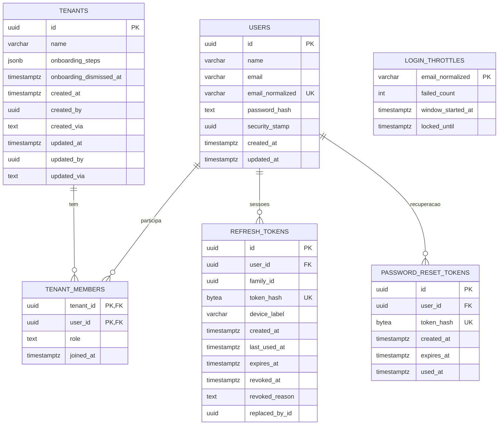

# Data Model — 001 Contas e Espaços

Recorte de `docs/modelo-de-dados.md` (fonte da verdade). Esta feature cria as tabelas globais de
identidade e a infraestrutura base das tabelas de Espaço.



## Entidades

### User (`users`)

| Campo | Regra | Origem |
|---|---|---|
| name | 1–60 caracteres após trim | FR-001 |
| email | trim; formato de e-mail válido; até 254 | FR-001 |
| email_normalized | `lower(trim(email))`; **UNIQUE** | FR-003, Edge Cases |
| password_hash | `PasswordHasher<User>`; senha 8–128 caracteres, sem outra regra | FR-002 |
| security_stamp | novo valor a cada troca/redefinição de senha | FR-012 |

### Tenant (`tenants`) — Espaço

| Campo | Regra | Origem |
|---|---|---|
| name | 1–60 após trim; padrão "Finanças de <primeiro nome>" (research R10) | FR-004, FR-013 |
| onboarding_steps / onboarding_dismissed_at | criados vazios; usados na 006 | 006 FR-007 |
| auditoria | `created_*`/`updated_*` pelo AuditInterceptor (sem soft delete) | arquitetura §4 |

### TenantMember (`tenant_members`) — Participação

| Campo | Regra | Origem |
|---|---|---|
| role | `owner` (único valor na v1) | FR-005 |
| restrições v1 | `UNIQUE (user_id)` e `UNIQUE (tenant_id)` — removíveis quando houver compartilhamento | FR-005, FR-005a |

### RefreshToken (`refresh_tokens`) — Sessão

| Campo | Regra |
|---|---|
| family_id | identifica a sessão (aparelho); vai no access token como `sid` (research R3) |
| token_hash | SHA-256 do token opaco de 256 bits |
| expires_at | `last_used_at + 90 dias` (FR-009) |
| revoked_reason | `logout`, `rotated`, `reuse_detected`, `password_changed`, `password_reset` |

**Transições de uma sessão (família):**

```
login/cadastro ──▶ ATIVA ──refresh──▶ ATIVA (token novo; o antigo fica revoked_reason=rotated)
                    │
                    ├── logout ─────────────────▶ ENCERRADA
                    ├── troca de senha (outras) ▶ ENCERRADA   (a sessão atual continua)
                    ├── redefinição de senha ───▶ ENCERRADA   (todas)
                    ├── reuso de token rotacionado ▶ ENCERRADA (família inteira, reuse_detected)
                    └── 90 dias sem uso ────────▶ EXPIRADA
```

### PasswordResetToken (`password_reset_tokens`)

Token de 256 bits, guardado como hash; válido 1 h; uso único (`used_at`). Pedir um novo não invalida
os anteriores ainda válidos. Uso bem-sucedido: troca a senha, muda `security_stamp`, revoga todas as
sessões (FR-011, FR-012).

### LoginThrottle (`login_throttles`)

Regras em research R5. Existe também para e-mails sem conta (SC-004).

## Infraestrutura base (sem tabela nesta feature)

- `IEntity`, `ITenantEntity`, `IAudited`, `ISoftDeletable`, `IArchivable`, `TenantEntity` (arquitetura §3.2).
- Filtros nomeados `Tenant` e `SoftDelete`; interceptors Tenant → SoftDelete → Audit (arquitetura §3.3–3.4).
- Convenção de FK composta `(tenant_id, x_id)` (arquitetura §3.5).
- Validadas com as entidades de sonda `ProbeParent`/`ProbeItem`, que existem **apenas** no contexto de testes (research R1).
